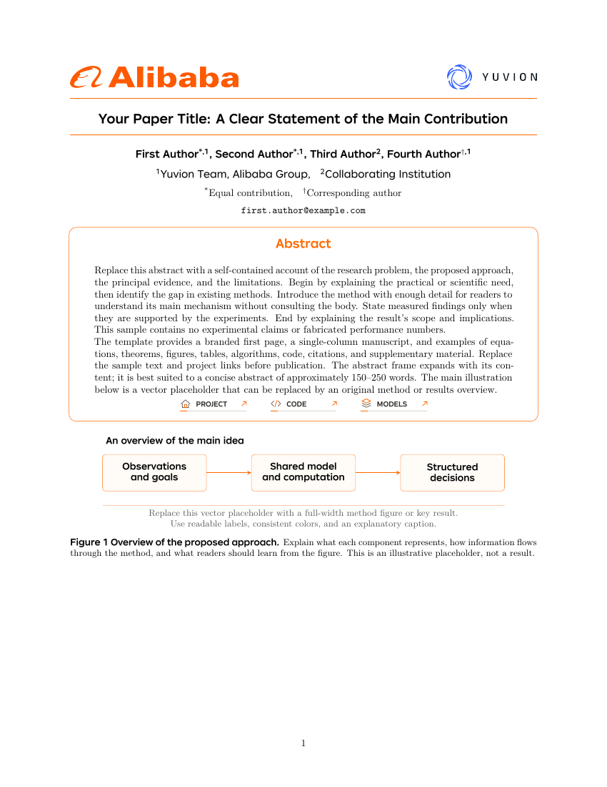

# Alibaba / Yuvion Paper Template

Yuvion Team, Alibaba Group 的单栏论文与技术报告模版。首页使用 Alibaba Group
大 Logo、Yuvion Logo、橙色标题横线和圆角摘要框，正文与格式参数参照
[VideoJev](https://arxiv.org/abs/2610.18615) 的公开论文源码整理。

**[下载 Overleaf ZIP](https://github.com/Alibaba-VELLDEPTH/yuvion-paper-template/raw/refs/heads/main/overleaf.zip)**
· **[查看 6 页 PDF](preview.pdf)** · **[版式参数与来源](FORMAT.md)**



## Overleaf

1. 下载上方 ZIP，在 Overleaf 选择 **New Project → Upload Project**。
2. 将 `main.tex` 设为主文件，编译器选 **XeLaTeX**。
3. 修改 `metadata.tex` 中的标题、作者、单位、邮箱及项目链接。
4. 替换 `sections/` 中的示例内容和 `figures/teaser.tex` 中的首页主图。
5. 在 `references.bib` 中维护参考文献。

## 本地编译

```bash
latexmk -xelatex main.tex
```

也可运行 `tectonic main.tex`。所有 Logo 和标题字体均随源码提供。

## 内容与结构

```text
main.tex                主文件
metadata.tex            标题、作者、单位、项目链接与 draft 开关
alibaba-report.sty      统一排版参数
sections/               摘要、正文、附录与示例
figures/teaser.tex       首页矢量主图占位示例
logos/                  Alibaba Group 与 Yuvion Logo
fonts/                  参考论文源码附带的标题及作者字体
references.bib          示例参考文献
FORMAT.md               详细格式约定、来源与差异
preview.pdf             同一份源码实际编译的 6 页 PDF
overleaf.zip            可直接上传 Overleaf 的完整项目
```

示例包含三级标题、段落小标题、项目列表、公式、对齐公式、定理与证明、
三线表、双子图、算法、代码、脚注、数字引用、补充材料目录和附录。
表格中的 `--` 是待填写位置，不是实验结果。

```latex
\citep{vaswani2017attention}     % 数字引用
\citet{vaswani2017attention}     % 作者 + 数字引用
Figure~\ref{fig:teaser}          % 图交叉引用
Equation~\eqref{eq:objective}    % 公式交叉引用
\includegraphics[width=\linewidth]{figures/your-figure.pdf}
\todo{待修改内容}                % 受 metadata 中 draft 开关控制
```

正文为 US Letter 单栏、10pt、12pt 基线距，左右页边距各 25mm。
首页后显式换页，正文从第二页开始。详细参数见 [FORMAT.md](FORMAT.md)。

## 版本替换

当前主分支仅保留这套新版模版。原 `double-column/`（CVPR 风格）和
`single-column/`（NeurIPS 风格）已撤下，仍可从
[Git 历史](https://github.com/Alibaba-VELLDEPTH/yuvion-paper-template/commits/main/)
查阅和恢复。

## 来源

- 版式参照：[VideoJev 公开论文与源码](https://arxiv.org/abs/2610.18615)。
- Alibaba Group Logo：[集团官方媒体资源页](https://home.alibabagroup.com/en-US/resource-logos)。
- Yuvion Logo：本仓库原团队品牌素材。
- 标题与作者字体：原论文源码附带的 JD LangZhengTi2；正文采用同源的 Latin Modern。

这是团队定制的论文模版，不是阿里巴巴集团统一发布的官方模版。
字体和品牌素材保留原权利归属，本仓库不额外授予第三方素材权利。
会议或期刊投稿请遵循目标 venue 的官方 author kit。

## 验证

已通过 Tectonic / XeTeX 实际编译，并逐页检查 6 页 PDF。
示例无未定义引用、缺字或超出页边距的文本。
